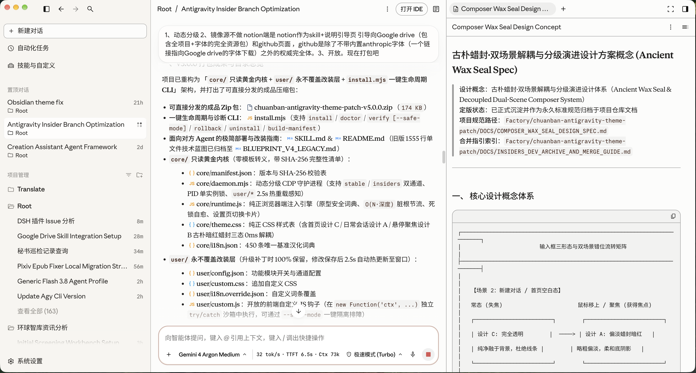
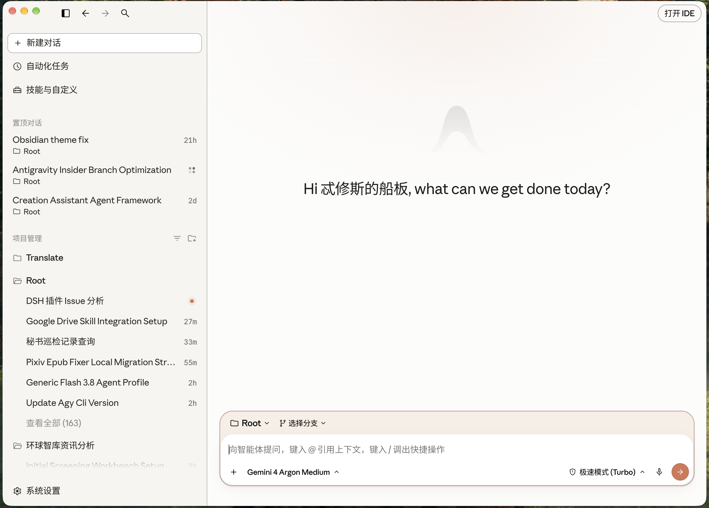

# JackHua's Antigravity 汉化、字体与主题增强版 (v5.2.2 · 完美适配 Antigravity 2.32.1+)

[-339933.svg)](https://nodejs.org/)

> **本项目基于 [Anarcadia/chuanban-antigravity-theme-patch](https://github.com/Anarcadia/chuanban-antigravity-theme-patch) 进行二次开发与深度增强。**  
> 针对原版在日常使用中的三大核心痛点（**“客户端退出重启后变回英文”**、**“Windows 白底输入框鼠标工字光标发白隐形”** 与 **“静态 256K 上下文水位线导致 512K 模型显示超 100%”**），独创了双启动联合守护机制、标准色彩自适应工字光标与动态模型上下文水位线识别，并补全了近百条新版词条（**990+ 条深度汉化**），提供开箱即用、无感常驻的母语级 Antigravity 体验。

---

## 🌟 JackHua 增强版五大核心突破（v5.2.2 专属优化）

| 核心增强功能 | 原版常见痛点 | 本版（v5.2.2）解决方案 |
| :--- | :--- | :--- |
| **1. 客户端退出重启自动保持中文** | 原版依赖常开命令行或容易随客户端退出被 Windows 作业树强杀；每次完全退出或关机重启后变回英文，需要用户反复敲命令或手动重新汉化。 | **独创 Windows 快捷方式“双启动联合守护”架构**：安装时自动感知并劫持修复桌面（含 OneDrive 桌面）与开始菜单快捷方式（保留官方原生高清图标）。每次正常双击图标打开 Antigravity，后台自动在 0 秒内静默核验并拉起守护进程，**实现日常退出重启、关机开机 100% 自动保持中文**！ |
| **2. 白底输入框鼠标工字型 (I-beam) 标准防隐形** | Windows DWM 硬件加速与 Chromium 反色机制冲突：白底输入卡片下鼠标工字光标经常被错误渲染成“纯白色”，在白底框内移动完全看不清光标位置。 | **系统标准默认粗细 + 强制 `color-scheme` 色彩自适应**：彻底去除过粗过宽的自定义图形遮挡，采用 100% 系统标准默认大小与细度的工字指针（1px 纤细主干），并通过精准声明 `color-scheme` 与 `caret-color` 锁定白天纯黑、黑夜纯白，点选字与字之间精准绝不遮挡。 |
| **3. 512K / 多模型上下文水位线自适应** | 原版写死静态 `256k` 上限；当新版本/新模型（如 Gemini 4 Hydrogen）提升至 `512K` 时，指标胶囊与压缩水位线会显示诸如 `483k/256k (189%) · 距压缩余 0`。 | **Protobuf 原生模型上限动态识别**：直接从会话 SQLite 的 `ContextWindowMetadata` 实时读取当前模型的真实 `max_context_tokens`（自动识别 `512k`、`256k`、`160k`、`840k` 等不同模型窗口，默认兜底 `512k`），百分比与剩余额度 100% 精准。 |
| **4. 新版全功能深度汉化补全（990+ 词条）** | 官方近期版本新推功能（如远程控制、二维码扫码连接、WSL 切换、浏览器内嵌安全拦截等）在旧版补丁中大量出现英文残留。 | **全量补齐官方近期新版特性词条**：全面覆盖「远程控制 (Remote Control)」、「设备名称 (Device Name)」、「复制链接/扫码在远程控制中打开」、「适用于 Linux 的 Windows 子系统 (WSL)」、「内置浏览器内嵌限制与私密连接警示」等近百条高频界面词汇，总词条扩充至 990+ 条！ |
| **5. 智能唤醒指令与离线 `重新汉化.bat`** | 官方大版本更新覆盖核心文件后，用户往往需要去翻看文档输入复杂安装参数。 | **多层自愈容灾体系**：根目录预置一键免配置批处理 `重新汉化.bat`，双击 2 秒内恢复；同时在 `SKILL.md` 中绑定高频短语，在客户端对话框直接发「重新汉化」或「修复汉化」，Agent 即自动静默完成修复。 |

---

## 🔗 核心资源链接

| 端点名称 | 链接地址 | 定位与包含内容 |
| :--- | :--- | :--- |
| **1. 本项目 GitHub 代码库** | [**JackHua6/Antigravity**](https://github.com/JackHua6/Antigravity) | **增强版成品代码与安装器**。包含已修复光标与重启守护的 `core/`、改装层 `user/`、一键安装器 `install.mjs` 及 Agent 专属 `SKILL.md`。 |
| **2. Google Drive 字体包（必下）** | [**Google Drive 官方共享文件夹**](https://drive.google.com/drive/folders/1NX92SgVUqtSjWg6bt6sIJXy-cn7J_boC) | 内置 **Anthropic 官方原版字体族**（`Anthropic Sans` / `Anthropic Serif` / `Anthropic Mono`）与 **更纱黑体超集**（`Sarasa-SuperTTC.ttc`）。 |
| **3. 上游原版项目致敬** | [**Anarcadia/chuanban-antigravity-theme-patch**](https://github.com/Anarcadia/chuanban-antigravity-theme-patch) | 感谢船板原作者提供的优秀黄金内核基础与配色灵感。 |

---

## 🖼️ 实机样式演示

### 1. 三栏工作台：高对比暖纸主题 + 古朴暗红蜡封输入框 + 同行实时指标胶囊 + 黑色工字型光标

### 2. 新建对话首页：全界面深度汉化 + 聚焦浮现淡雅暗红蜡封外框

---

## 🚀 极简部署与日常使用指南

### 一、新用户一键安装（推荐直接发给 AI Agent）
1. **下载安装字体**：从 [**Google Drive 全套资源包**](https://drive.google.com/drive/folders/1NX92SgVUqtSjWg6bt6sIJXy-cn7J_boC) 下载字体解压安装，并确保本机已安装 **Node.js `>= 22.0.0`**（推荐 `>= 22.13.0`）。
2. **复制发给你的 AI Agent（Antigravity / Claude Code / Codex / Cursor 等）**：

> **💬 复制发给 Agent（一键安装）**：  
> 请帮我克隆 `https://github.com/JackHua6/Antigravity.git`，严格按照仓库内的 `SKILL.md` 执行 `node install.mjs doctor` 和 `node install.mjs install`，帮我一键部署好该增强版汉化补丁并完成快捷方式守卫与光标增强配置。

### 二、日常使用体验
- **日常关闭与重新打开**：无需任何额外操作，直接双击桌面原版 Antigravity 图标启动，**100% 自动保持中文**。
- **未来版本升级容灾**：若客户端大版本更新覆盖了内部配置，双击本地目录的 `重新汉化.bat`，或在客户端对话框中对 Agent 发送 **“重新汉化”**，即可 2 秒自动恢复。

---

## 🕒 版本演进简史

- **2026-11-17（v5.2.2 · 上下文水位线动态适配）**：
  1. **动态上下文上限自适应（修复 512K 模型显示超 100% Bug）**：移除写死的 `256000` 上限，直接解析会话 SQLite 中 `ContextWindowMetadata.max_context_tokens` 真实上限（支持 Gemini 4 Hydrogen 的 `512k`、Flash/Argon 的 `256k`、Claude 的 `160k`/`840k` 等按调用实时跟随，默认兜底 `512k`）；
  2. **自动配置迁移**：`install.mjs install` 自动将旧版 `user/config.json` 中遗留的静态 `256000` 迁移为 `"auto"`。
- **2026-11-12（v5.2.1 · 新版功能深度汉化补全）**：
  词条总数扩充至 990+ 条，补全远程控制 (Remote Control)、设备名称、WSL、内置浏览器安全提示与步骤确认等新功能界面。
- **2026-11-12（v5.2.0 · JackHua 增强版首发）**：
  1. **首创 Windows 快捷方式双启动联合守护（`LaunchAntigravity.vbs`）**：彻底解决客户端退出重启变回英文的体验缺陷，安装时自动感知并绑定桌面与开始菜单快捷方式，开机/重启客户端 100% 自动保持中文；
  2. **首创 Chromium DWM 白底工字型光标 (I-beam) 标准防隐形**：恢复系统标准默认粗细与大小的工字指针（1px 纤细主干），通过上下文色彩方案强制声明，彻底根治白底输入框中鼠标光标发白隐形的问题，白天纯黑、黑夜纯白，点选文字精准不遮挡；
  3. **新增一键离线修复脚本 `重新汉化.bat` 与全场景智能短指令触发**。
- **2026-11-11（v5.1.4 原版）**：
  修复实时指标胶囊运行态同行稳定化与 `flex-col` 越界溢出。
- **2026-11-11（v5.1.3 原版）**：
  适配 Antigravity 2.31.0 Worktree、900条汉化词典、SQLite O(1) 增量遥测与 WeakMap 隔离缓存。
